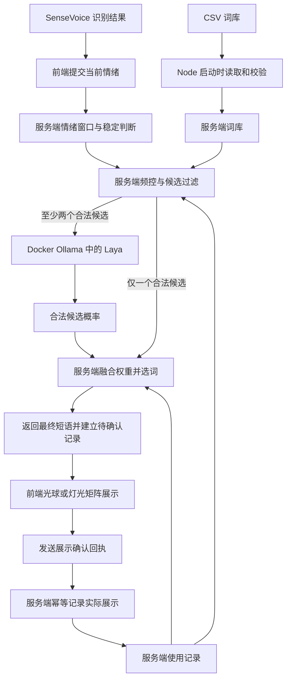

# Aura Laya 情绪陪伴与 CSV 词库决策实施计划

日期：2026-10-15（America/New_York）

方案版本：v1.3；实施状态：业务代码已落地，官方 SDK、CSV、服务端决策及展示回执已接通，验收记录见第 12 节。下文保留实施前的方案与约定；真实麦克风的长期体验调参仍待人工验收。

目标：将短回应从通用生成式 LLM 选词改为服务端的 Laya 决策模型与规则协同。SenseVoice 识别情绪后，Node 服务进入对应的 CSV 词库，通过已经部署在 Docker Ollama 中的 Laya 评价候选短语，再结合服务端保存的使用记录、基础权重和冷却时间，直接返回一句最终短语。前端只负责提交识别结果、显示返回文字及发送展示确认。

核心流程：**识别情绪 → 服务端确认情绪并查找词库 → 过滤冷却中的短语 → Laya 评价候选 → 服务端融合权重并选词 → 前端展示 → 回执确认后由服务端记录使用。**

## 1 已确定的需求与实施边界

根据讨论，本版采用以下约定：

- 回应依据声学情绪，不根据转写内容判断事件、意图或表达含义。
- 每种情绪对应一个候选词库；同一句话可以用于多种情绪。
- 词库由 CSV 文件维护，支持调整文字、情绪归属、基础权重、冷却时间和启用状态。
- 选词同时参考使用记录与权重，减少连续重复和短时间内频繁出现。
- CSV 保存人工配置；Node 在内存中单独管理使用记录，动态降权不回写基础权重。
- 候选选择、概率融合、权重计算、冷却和使用次数均由服务端负责。前端不读取词库、不抽词，也不保存展示历史或使用次数。
- 没有合适候选时跳过文字，保留正常情绪灯效。
- 使用本地已部署的 `laya:322m-multilingual-mlx-fp16`，不新增模型训练任务或数据库。
- Node 后端使用 Ollama 官方 JavaScript/TypeScript SDK 的 `systemone()` 方法调用决策模型，SDK 作为服务端运行依赖。
- SenseVoice 决定声学情绪标签，服务端决定词库归属和硬性频控，Laya 仅评价合法候选的适合程度；模型不能修改情绪映射、CSV 权重或冷却时间。
- 替换原通用生成式 LLM 调用和代理配置，沿用现有麦克风、SenseVoice、转写和两种可视化能力。

下面的时间参数、初始短语、文件拆分和记录生命周期属于本版实施默认值，可根据体验调整。首版不包含管理页面、CSV 在线编辑、自动学习权重、跨设备历史或文件热更新。

## 2 当前实现与改造入口

实施前现状依据共享短回应协议、`server/llm.ts`、短回应路由、前端调度、`src/reaction/context.ts` 和矩阵字形布局。旧模型调用与前端上下文模块已在实施中删除，当前实现入口见第 12 节。

| 当前实现 | 本版变化 |
| --- | --- |
| LLM 根据转写和声学情绪选择 11 条固定短语之一，或返回 NONE | 按情绪查找 CSV 候选，使用 Laya 概率与规则选词，或按规则跳过 |
| 候选短语及其联合类型写死在 TypeScript 中 | CSV 成为唯一词库来源，保留通用格式与展示能力校验 |
| 浏览器逐次调用 POST /api/reaction，请求通用模型 | 浏览器提交情绪，Node 统一调用 Laya、选词并返回最终文字 |
| 前端聚合最近转写，按语音时长汇总情绪 | 服务端保存短期情绪窗口并判断稳定性，转写不进入决策输入 |
| 文字展示 2.5 秒，清除后至少保留 5 秒灯效 | 保留展示节奏，并增加短语冷却、近期降权和展示频控 |
| 日志记录 modelOutput、finishReason 和大模型回复 | 记录词库版本、Laya 候选概率、最终选词、权重、使用次数和跳过原因 |

SenseVoice 当前提供情绪标签，未提供可直接使用的情绪概率。本版的片段一致性只用于稳定判断，不包装成模型置信度。Laya 返回的是候选选择概率，也不能解释为用户真实情绪的概率。新流程去掉原通用模型的文本生成，但仍包含一次本地决策推理；端到端响应受音频分段、两项模型推理、稳定判断和展示间隔影响。

## 3 架构与职责

### 3.1 已核对的本地部署

2026-10-15 通过已有容器及接口核对以下信息：

| 项目 | 本机实际值 |
| --- | --- |
| Ollama 容器 | ollama，运行中，镜像为 ollama/ollama:latest |
| Ollama 运行版本 | 0.40.1 |
| Laya 完整模型标签 | laya:322m-multilingual-mlx-fp16 |
| 模型 ID | 63b6e37ecedb |
| 模型规模与文件大小 | 321.89M 参数，约 678 MB |
| 模型能力 | decision |
| 当前配置的上下文长度 | 1024 |
| 宿主机地址 | http://127.0.0.1:11434 |
| Web 容器可达地址 | http://host.docker.internal:11434 |
| 决策接口 | POST /v1/systemone |

宿主机使用合成的 `sad` 情绪状态和三条陪伴短语调用决策接口，已获得 HTTP 200。响应包含 `answers.phrase.choice`、各候选的 `probabilities`、`confidence` 和 `usage`；此次返回 `support_understand`，其中 `support_here`、`support_with_you`、`support_understand` 的概率分别约为 0.2845、0.2518、0.4637。该测试确认协议和本地推理可用，不作为陪伴效果或性能验收。

另在现有 Web 容器中访问上述容器地址的 `/api/version`，获得 HTTP 200 和版本 0.40.1。Ollama 与 Web 当前位于不同 Docker 网络，本版复用已有 `host.docker.internal:host-gateway` 映射，经宿主机映射端口访问。不要将容器内的 `127.0.0.1` 作为 Ollama 地址，也不要假设 `http://ollama:11434` 已在当前网络中可解析。

使用完整模型标签，避免短名 `laya` 指向不同的默认检查点。Laya 通过决策接口返回结构化选择，不生成展示文字；接入依据为 [Ollama System One 接口](https://docs.ollama.com/api/systemone)与[已部署模型标签](https://ollama.com/library/laya:322m-multilingual-mlx-fp16)。

### 3.2 模块分工

CSV 加载、情绪窗口、候选过滤、Laya 调用、最终抽取和使用记录全部集中在 Node 服务。前端只作为识别结果的传递方和文字展示方，不获取候选表或概率集合。



- **服务端决策服务**负责 CSV 加载、情绪稳定、硬性频控、Laya 调用、最终抽取和返回文字。
- **Laya 适配器**通过 Ollama 官方 SDK 提交情绪状态与候选短语，管理请求期限和取消，并校验返回的标签和概率；不使用聊天、文本生成或 embedding 接口。
- **服务端记录模块**保存分客户端的情绪窗口、已确认展示、待确认下发及请求去重信息，统一计算冷却和近期次数。
- **前端请求模块**透传当前识别标签与请求标识，处理取消和过期响应；只保留当前任务和最新待发送片段。
- **展示组件**渲染服务端返回的文字，维护当前动画计时，并发送轻量展示回执。当前显示 ID 和计时器属于界面状态，不构成前端历史记录。

决策、校验和记录管理使用独立的服务端 TypeScript 模块。时间和随机数通过接口注入，以便重现边界情况；React 组件中不包含选词、降权或使用次数逻辑。

### 3.3 Ollama 官方 SDK 接入与配置

Node 使用官方 npm 包 `ollama`，从其 Node 入口导入 `Ollama`，创建客户端后调用 `systemone()`。客户端的 `host` 读取 `OLLAMA_BASE_URL`，填写 Ollama 服务根地址，路径和请求序列化交给 SDK 处理。该方法对应 `POST /v1/systemone`，返回一次结构化 JSON 响应。[官方 SDK 的 System One 用法](https://github.com/ollama/ollama-js#systemone)

首版计划锁定 `ollama@0.6.4`，该发布包已提供 `systemone()`、`SystemOneRequest` 和 `SystemOneResponse`。实施时将 SDK 加入 `dependencies` 并提交锁文件；后续升级需重新验证决策协议、取消和错误处理，不跟随未发布的主分支代码。[官方 npm 发布包](https://registry.npmjs.org/ollama/0.6.4)

本机接口无需 API key；请求包括固定模型名、结构化 `state` 和一个 `choice` 问题，不发送 `messages`、`temperature`、`stream` 等生成参数。[官方接口说明](https://docs.ollama.com/api/systemone)

- `state` 只包含当前已确认的情绪及最多三个近期情绪标签，并明确用途为情绪陪伴，不包含转写原文、音频或事件推断。
- `questions.phrase.criteria` 由服务端从 CSV 构造：键为短语 ID，值为展示短语；问题说明由服务端固定，要求只评价给定情绪下的陪伴措辞。
- 候选、使用记录和词库版本全部由服务端取得，浏览器不提交候选 ID、概率、权重、历史、模型名、上游地址或问题模板。
- 首版每种情绪最多配置 20 条启用短语，超限时校验报错；完整请求需适配本机 1024 上下文，越界时报告错误，不能截断后继续选择。官方 `choice` 接口接受 2–26 项，本版采用更小的应用上限。[决策能力说明](https://docs.ollama.com/capabilities/decision)
- 零候选直接跳过；仅一个合法候选直接使用规则选择，不为了调用模型而添加虚假的第二项。两个及以上候选才调用 Laya。该分支记录为 `single_candidate`，不伪造模型概率或调用记录。

SDK 接入统一封装在 `server/laya.ts`：使用官方请求和响应类型，在适配器内转换为业务结果；SDK 类型声明不能替代第 5.3 节的运行时校验。浏览器不导入 SDK，也不直接连接 Ollama。

超时和取消按单次调用隔离。当前 SDK 的 `systemone()` 不接收独立的 `signal` 参数，`abort()` 只管理流式请求；本版通过 SDK 支持的自定义 `fetch` 注入传输适配，将本次请求取消信号与 `LAYA_TIMEOUT_MS` 合并，并为每次决策创建独立客户端。传输适配只负责信号传递，接口路径、请求正文和响应处理仍由 SDK 完成。清理计时器及监听器时不能中断其他客户端的决策。[SDK 实现与取消行为](https://github.com/ollama/ollama-js/blob/main/src/browser.ts)

SDK 异常在适配器内转换为已有的超时、模型缺失、上游不可达和响应非法等业务错误。依赖版本缺少 `systemone()` 时视为部署配置错误，不改走聊天接口或手写 HTTP 决策请求。

| 配置 | 初始值与用途 |
| --- | --- |
| OLLAMA_BASE_URL | 宿主机开发默认 http://127.0.0.1:11434 |
| OLLAMA_DOCKER_BASE_URL | Compose 默认 http://host.docker.internal:11434，注入容器中的 OLLAMA_BASE_URL |
| LAYA_MODEL | laya:322m-multilingual-mlx-fp16 |
| LAYA_TIMEOUT_MS | 默认 5000；允许 1000–10000 毫秒 |
| REACTION_CATALOG_PATH | config/reaction-phrases.csv |

复用现有 Ollama 容器和已下载模型，不在 Aura Compose 中重复创建模型服务。保留宿主机映射，移除旧代理相关 `LLM_*` 配置。Ollama 故障或模型不可用只影响短回应，不改变 SenseVoice 的健康检查。

## 4 CSV 格式与维护方式

### 4.1 文件位置与字段

计划新增 `config/reaction-phrases.csv`，编码为 UTF-8，允许 UTF-8 BOM；一行表示一条短语。

| 字段 | 规则 | 用途 |
| --- | --- | --- |
| id | 必填；字母、数字、下划线或连字符；1–64 字符；全文件唯一 | 稳定关联使用记录 |
| text | 必填；1–2 个英文词，允许英文缩写和末尾一个句号或感叹号 | 实际显示文字 |
| emotions | 必填；使用内部情绪标识，多个值以竖线分隔 | 定义候选词库归属 |
| weight | 必填；有限正数 | 基础选择权重，不表示识别置信度 |
| cooldown_seconds | 必填；非负整数，单位为秒 | 同一句话两次展示之间的最短时间 |
| enabled | 必填；true 或 false | 临时启用或停用 |

`emotions` 支持 `neutral`、`happy`、`sad`、`angry`、`surprised`、`fearful`、`disgusted`。`unknown` 始终跳过文字，不配置对应短语。平静情绪默认没有启用的候选，后续可以通过 CSV 开启。

相同短语只维护一行，通过多个情绪归属复用。同一句话的小幅文字修改保留 ID；不要把旧 ID 分配给含义完全不同的新短语。

### 4.2 初始词库草案

以下内容作为实施时的初始配置，不代表本轮已经创建 CSV 文件：

```csv
id,text,emotions,weight,cooldown_seconds,enabled
joy_awesome,Awesome!,happy,2,60,true
joy_lovely,How lovely!,happy,1,60,true
support_here,I'm here.,sad|fearful|angry|disgusted,3,60,true
support_with_you,With you.,sad|fearful,2,60,true
support_understand,I understand.,sad|angry|disgusted,1,90,true
surprise_oh,Oh!,surprised,1,60,true
surprise_wow,Wow!,surprised,1,60,true
neutral_got_it,Got it.,neutral,1,90,false
```

低落、紧张等词库可以共享陪伴短语。惊讶反馈采用简短呼应，不推断惊讶来自好事还是坏事。`Congrats!`、`Good luck!`、`Anytime!` 等依赖具体事件或意图的短语不进入初始词库。

### 4.3 加载与校验

使用支持标准引号与转义的 CSV 解析库，不能直接按逗号拆分字符串。允许 LF、CRLF、BOM 和空白行；按列名读取，检查缺列、重复列、未知列及列数错误。

读取后完成以下校验，并报告文件名、行号、字段与原因：

1. 检查必填值、ID 唯一性、情绪标识、布尔值和数字范围；同一行不能重复列出相同情绪，任一情绪的启用候选不超过 20 条。
2. 统一去除文字首尾空格，将弯撇号规范为英文撇号，再检查英文词数和允许字符；缩写计为一个词。
3. 按规范化文字检查重复，大小写或末尾句号、感叹号不同不能用来创建重复短语、绕过冷却。
4. 使用与矩阵渲染相同的字形和字距计算宽度，确保不超过 64 列；不截断文字，也不偷偷删除不支持的字符。
5. 停用行同样检查格式，避免重新启用时暴露隐藏错误。只有表头或所有行均停用属于合法空词库，运行时正常跳过。

现有矩阵字形定义和宽度测量应提取到共享模块，供服务端校验和前端布局复用。短语不再需要加入第二份 TypeScript 白名单；运行时类型通过校验构造，不能用强制类型转换绕过校验。

首版采用整份文件校验：存在错误时短回应词库不可用，语音识别和灯效继续工作，不静默跳过错误行或调用旧通用模型。

### 4.4 编辑与生效

维护者可以使用文本编辑器或表格软件修改 CSV，保存时保留列名和 UTF-8 编码。使用 `enabled=false` 停用短语；使用 `emotions` 扩展归属；修改 `weight` 和 `cooldown_seconds` 调整偏好与重复频率。

服务端启动时加载一次词库。提供计划中的 `npm run check:reactions` 校验命令，复用应用的加载和校验模块，只负责报告问题，不产生另一套解析规则。

生效流程为：编辑 CSV → 执行词库校验 → 重启 Web 服务。后续决策直接使用服务端新词库，前端不需要刷新词库缓存。服务重启同时清空本版的内存使用记录；首版不监听文件变化，也不提供在线重载接口。

Docker 运行镜像需要包含默认 `config/` 目录；Compose 将宿主机 `config/` 目录以只读方式挂载到容器对应位置，使词库修改后仅需重启 Web 服务。未使用挂载的部署，需要将更新后的 CSV 随镜像重新构建。路径可由 `REACTION_CATALOG_PATH` 指定，默认指向项目下的词库文件。

## 5 使用记录与选词算法

### 5.1 配置和记录分开管理

CSV 中的 `weight` 始终作为基础值。Node 使用内存记录模块，按 `clientId + phraseId` 保存上次确认展示时间和最近 5 分钟的确认时间列表，另保存该客户端的上次短语、整体反馈时间、各情绪反馈时间和待确认决策。

`clientId` 标识一个页面实例，由前端创建后随请求携带；`sessionId` 标识一次录音。前端只持有这些身份标识，不持有使用历史。切换情绪、显示方式、开始新录音或关闭再开启功能，继续使用相同 `clientId`，后端保留其冷却记录，同时重置必要的情绪上下文和任务。

`generation` 是同一页面内单调递增的任务代次，清空、关停、隐藏或开始新录音时递增；`sequence` 标识该代次内的识别片段。服务端拒绝旧代次或重复片段更新情绪窗口。新代次可以重置情绪上下文，但不能清空该客户端的使用记录。

新页面或刷新页面会产生新的 `clientId`，不同客户端相互隔离，不能共用一张全局频次表而影响彼此。服务重启清空内存记录。空闲客户端记录按 TTL 释放，TTL 至少覆盖 300 秒统计窗口和词库中最长冷却；设置记录数量上限，满额时返回 busy，不驱逐仍有效的记录来绕过冷却。

超过统计窗口的确认时间及时淘汰，上次确认时间单独保留。所有频控时间采用服务端单调时钟；客户端上传的时间不作为冷却或次数依据。实际绘制时间与回执接收时间可能有网络延迟，本版以服务端收到有效展示回执的时刻开始计算已确认记录的冷却。

### 5.2 候选过滤和加权抽取

一次决策完全在服务端按以下顺序执行：

1. 校验客户端、录音代次和识别序号，更新服务端情绪窗口，确认词库可用、情绪稳定、界面可接收新文字且反馈间隔已满足。
2. 找出 `enabled=true` 且 `emotions` 包含当前情绪的短语。
3. 根据服务端记录排除仍在冷却或待确认预留中的短语；从未使用的短语不受历史冷却限制。
4. 如果仍有两条或更多候选，且其中包含上一条实际展示的短语，则优先排除上一条，减少连续重复。若只剩一条，只要冷却已结束，允许再次使用。
5. 对剩余候选计算近期展示次数，并得到实际权重。
6. 若有两个及以上候选，调用 Laya 获取同一候选集合的概率；仅一个候选时直接进入规则选择。
7. 将候选概率与近期降权后的基础权重融合，归一化后随机抽取一条；返回前再次核对上下文及频控，避免并发或过期结果突破限制。
8. 以本次请求的 `turnId` 作为客户端范围内唯一的 `decisionId`，原子建立待确认下发记录，并直接返回短语正文。展示回执成功后才增加已确认次数。

设短语的基础权重为 `w`，最近 300 秒实际展示次数为 `n`：

**使用频率调整后的权重 = w / (1 + n)**

设通过校验并归一化的 Laya 概率为 `p`，当前候选数为 `N`，混合系数初始设为 `α = 0.2`：

**模型偏好因子 = (1 − α) × p + α / N**

**最终抽取权重 = w / (1 + n) × 模型偏好因子**

**被选中概率 = 该短语最终抽取权重 / 所有合法候选最终抽取权重之和**

上述融合公式是本项目的初始策略：保留模型偏好，并给人工维护的合法候选保留少量选择机会。`α` 属于程序策略参数，不是 CSV 单条配置，也不是 Laya 接口参数。若候选概率相同，抽取退化为原有基础权重与使用次数的加权选择。单候选分支直接返回该候选，不向日志填入虚构的 `p=1`。

Laya 的 `choice` 作为模型偏好记录，最终文字由服务端加权抽取并查表得到，因此最终短语可能与 `choice` 不同。前端直接显示响应中的文字。基础权重表达相对偏好，不承诺固定次数配额。近期次数移出窗口后，权重自然恢复；冷却属于硬限制，不会因为模型分数高或基础权重大就被绕过。只剩两条候选时，避免连续重复的规则可能使两条交替出现。

例如当前情绪为低落，整体与同情绪展示间隔均已满足；20 秒前曾针对紧张情绪展示 `I'm here.`：

| 短语 | 基础权重 | 近期情况 | 本次结果 |
| --- | ---: | --- | --- |
| I'm here. | 3 | 20 秒前显示，冷却为 60 秒 | 排除 |
| With you. | 2 | 最近 5 分钟显示 1 次，已过冷却 | 使用频率调整后的权重 1 |
| I understand. | 1 | 最近 5 分钟未显示 | 使用频率调整后的权重 1 |

假设 Laya 对后两条分别返回 0.6 和 0.4，则最终抽取权重为 0.58 和 0.42，本次选择概率为 58% 和 42%。这里的概率是公式示例，不是本机测试结果。若候选均在冷却中，返回跳过，不能临时取消冷却，也不自动抽取其他情绪的短语。

### 5.3 模型结果校验

服务端检查响应模型、问题名称、`type=choice`、`choice` 所属集合，以及概率键是否与请求候选一致。概率必须为有限的 0–1 数值，和应在浮点容差内接近 1，之后再归一化；缺项、额外标签、全零或非法数值均视为无效响应，不拿模型返回的自由文本显示。

`confidence` 只记录其原值，不作为本版自动拒绝阈值。几条近义陪伴短语同时适合时，分布接近并不等同于识别失败；该字段也不是情绪识别正确率。[官方决策说明](https://docs.ollama.com/capabilities/decision)

模型调用失败、超时或响应非法时跳过本次反馈，记录明确错误；不静默切换为纯随机模式，也不调用原通用 LLM。单候选规则选择是事先定义的正常分支，与模型失败降级区分记录。

## 6 情绪稳定与反馈节奏

### 6.1 初始参数

| 参数 | 初始值 | 作用 |
| --- | --- | --- |
| 情绪观察窗口 | 后端最近收到的 3 个有效语音片段 | 降低单段标签跳变造成的文字切换 |
| 情绪确认条件 | 最新标签在窗口中至少出现 2 次，且不是 unknown | 保证近期存在相同线索 |
| 识别候选有效期 | 15 秒 | 避免过时情绪在等待后突然触发 |
| 整体反馈间隔 | 每个 clientId 至少 10 秒，以服务端确认或未确认下发预留为准 | 控制不同短语、不同情绪的整体出现频率 |
| 同一情绪反馈间隔 | 至少 30 秒 | 持续同一种情绪时减少打扰 |
| 单条短语冷却 | 由 CSV 配置，初始主要为 60 秒或 90 秒 | 避免相同文字频繁出现 |
| 使用次数统计窗口 | 300 秒 | 为近期使用较多的短语降权 |
| 模型偏好混合系数 | α = 0.2 | 平衡 Laya 偏好与合法候选的选择机会 |
| Laya 请求期限 | 服务端默认 5 秒；浏览器总期限 12 秒 | 限制推理与接口等待，并允许取消 |
| 模型失败后的再次请求间隔 | 至少 5 秒，且需要新的有效语音 | 避免故障时连续请求 |
| 展示回执等待期 | 下发后最多 5 秒，且不超过本次识别候选有效期 | 区分已确认展示与未确认下发 |
| 文字展示时长 | 2.5 秒 | 沿用当前文字展示长度 |
| 文字清除后的灯效间隔 | 至少 5 秒 | 保留连续情绪动画 |

通用时间参数集中在服务端决策策略配置中，单条短语参数留在 CSV，避免在每行重复全局设置。前端仅使用响应中的展示时长及动画间隔控制界面。这些参数可调，不承诺首次反馈一定在固定秒数内到达。

### 6.2 识别结果的处理

前端将当前识别结果的 `emotion`、`isSpeech` 和识别序号传给 Node，不在浏览器内聚合情绪或维护候选。服务端以 `isSpeech` 判断有效片段，不读取转写内容，也不增加文字语义或词数门槛。目前识别适配器以“没有 nospeech 标签且转写非空”计算 `isSpeech`，本版保留这一识别契约，因此当前空转写结果仍不会触发反馈。音量不用于推断情绪。

`unknown` 片段占用观察窗口，但不能触发文字；最新片段是 `unknown` 时不沿用旧情绪选词。非语音结果不触发新决策。超过 15 秒没有有效语音后，新片段从空观察窗口开始。情绪稳定判断只影响短回应，灯效继续按现有识别结果更新。

前端至多保留一个最新待发送片段，不积压回应请求。后端按录音代次和识别序号更新窗口，相同片段不重复计入。文字或过渡动画正在播放时，前端只通过 `canDisplay=false` 报告界面状态，后端可以更新情绪窗口，但不生成新的文字。

服务端收到新的情绪或取消信号后，使已过期或不匹配的决策失效；模型完成后再次核对录音代次、当前情绪和候选有效期。同一情绪持续出现时可以保留兼容的在途任务。前端只做请求归属和界面有效性检查，不重新判断候选或改选文字。

### 6.3 调度与跳过

每次下发由服务端统一检查整体间隔、同情绪间隔、短语冷却和待确认状态。前端通过当前动画状态表明是否能够展示；单纯换一句话不能绕过后端频控。

只有新的有效识别结果才能产生新的待决策机会。后端不设置自动补发旧情绪的循环；候选超过 15 秒则丢弃。间隔未到、界面不可显示、没有候选或全部处于冷却时返回 skipped，等待新的识别结果。前端不根据词语冷却时间安排下一次选词。

停止录音时，已经进入处理流程的末段可以在有效期和间隔允许时展示一次；不能为了补发而等待冷却几十秒。清空记录、关闭功能、离开页面或开始新录音会取消旧候选。页面隐藏时不开始新展示，恢复可见后等待新的有效识别结果。

由服务端统一管理频控、失败退避和在途决策，替换旧的模型请求合并及 4 秒请求节流。每个 clientId 至多一个 Laya 请求和一个待确认结果，服务端初始模型并发上限为 2。请求去重和提交预留必须原子处理；Laya 异步返回后再次校验，不能让两个并发请求同时消耗同一个冷却窗口。客户端取消会传播到上游请求；前端仍须丢弃过期响应，不能假定断开连接就一定停止了模型内部计算。

## 7 展示确认与生命周期

后端选中短语后先建立待确认记录，响应携带最终 `text`、`decisionId`、录音会话、识别序号、情绪、短语 ID、有效期及展示时长。前端只检查是否属于当前任务、功能是否开启、页面是否可见以及响应是否过期，然后原样展示文字；不读取词库或再次抽取。

首次可见绘制后，前端向展示回执接口提交身份标识和 `decisionId`。Node 查找自己保存的待确认记录，核对归属、代次和期限，再幂等增加展示次数并启动已确认冷却。客户端不能通过回执指定另一个短语、上传次数或修改时间。

前端只需持有当前显示 ID、绘制状态和动画计时器。回执可以对同一 ID 做有限重试，服务端保证重复回执只记一次；React 重复执行、组件重绘、光球与矩阵切换也不能重复计数或延长展示期限。

HTTP 响应返回不等同于已展示。没有收到有效回执的结果标为 `delivery_unconfirmed`，不加入“已确认展示次数”；等待期到达后释放待确认任务，但本次下发仍保留相应的整体、同情绪和单短语预留至其冷却结束，避免回执丢失导致立刻重发。该策略可能略微减少反馈次数，但不会虚构已确认展示。尚未下发就取消或失败的任务无需建立这种预留。

页面隐藏、功能关闭、清空转写或切换录音会取消旧请求并清除当前文字。恢复可见后不重播旧文字。前端更新请求代次，后端在收到新代次时使旧上下文和未确认结果失效，同时保留该 clientId 已确认及必要的未确认防重复记录；这些操作不要求浏览器保存历史。

## 8 接口与监控

### 8.1 服务端词库

词库只在服务端启动时读取和校验，不新增面向前端的词库查询接口。服务端为规范化后的配置生成版本号，用于日志追踪；浏览器不加载词库、不缓存快照，也不负责同步版本。

词库加载失败时仅停用文字反馈，决策接口返回明确的配置错误，识别、转写和灯效仍可使用。修改 CSV 并重启后，下一个请求直接使用新配置。新流程接通后删除旧 `POST /api/reaction` 生成链路，改用以下决策和展示回执接口。

### 8.2 决策接口

新增 `POST /api/reaction/decision`，请求仅包括以下信息：

| 字段 | 用途 |
| --- | --- |
| clientId、sessionId、generation | 标识页面、录音与任务代次 |
| turnId、sequence | 请求去重、片段排序与响应归属 |
| emotion、isSpeech | 当前片段的识别结果 |
| canDisplay | 当前界面是否能够开始展示文字 |

近期情绪、候选集合、CSV 版本、权重及使用次数均由后端取得。前端不发送转写、音频、候选列表或历史，也不能指定模型名及上游地址。`canDisplay` 只提供界面状态，不能替代服务端频控判断。

成功响应使用 `status=replied`，返回请求归属、`decisionId`、`phraseId`、最终 `text`、对应情绪、展示期限、`displayMs` 和文字清除后的 `animationGapMs`。初始展示时长为 2500 毫秒，灯效间隔为 5000 毫秒。前端核对当前任务和展示期限后直接显示文字，不接收候选概率、抽取权重或近期次数。

正常跳过返回 `status=skipped` 和原因。CSV 缺失或非法分别归类为 `catalog_missing`、`catalog_invalid`；超时、模型不存在、上游不可达、忙碌和非法模型响应分别归类为 `decision_timeout`、`model_not_found`、`decision_unavailable`、`busy` 和 `invalid_model_output`。

服务端按 `clientId + turnId` 去重；同一请求重试不能重复调用模型、重新抽词或创建多份待确认记录。已有结果仍有效时返回相同结果，过期或失效时返回对应跳过原因。低于当前代次或已处理识别序号的请求不得恢复旧任务；较新代次只重置任务和情绪上下文，保留客户端使用记录。

关闭功能、隐藏页面、切换录音或清空记录均取消当前请求。加载和推理期间静默等待，按现有原则不显示转圈或生成文案。

### 8.3 展示回执接口

新增 `POST /api/reaction/displayed`。前端在首次可见绘制后提交 `clientId`、`sessionId`、`generation` 和 `decisionId`，不上传短语正文、使用次数或展示时间。后端根据待确认记录确定短语、情绪及应更新的频控状态。

同一 `clientId + decisionId` 的首次有效回执返回 `accepted`，重复回执返回 `duplicate`，均不得重复计数。未知 ID、归属不符、已失效或超期且未确认的决策不予计数；已经确认的重复回执只返回原有状态，不延长冷却。前端只对当前展示回执有限重试，不保存回执历史。

回执缺失时按第 7 节保留未确认下发的防重复预留，不把网络响应成功记成实际展示。该接口用于后端记账，不新增前端历史列表或本地存储功能。

### 8.4 结果与日志

| 情况 | 结果或处理 |
| --- | --- |
| Laya 评分成功 | 概率保留在服务端，继续融合权重并选择最终短语 |
| 成功选中 | 返回最终文字及展示信息，建立待确认记录，尚不增加已确认次数 |
| 收到首次有效展示回执 | 服务端增加使用次数并更新已确认冷却 |
| 回执超时 | 标记 delivery_unconfirmed，保留防重复预留，不增加已确认次数 |
| 仅一个合法候选 | 按规则选择，决策来源 single_candidate，无模型调用 |
| 非语音或 unknown | skipped，原因分别为 non_speech 或 unknown_emotion |
| 情绪未稳定 | skipped，原因 unstable_emotion |
| 情绪没有启用候选 | skipped，原因 no_candidate |
| 候选均在冷却 | skipped，原因 all_on_cooldown |
| 整体或同情绪间隔未到 | skipped，原因 global_interval 或 emotion_interval，等待新的有效识别 |
| 界面不可显示或存在待确认结果 | skipped，原因 display_unavailable 或 awaiting_display |
| 候选过期、被新结果替换或任务取消 | 丢弃候选，不增加已确认次数；已经下发的预留按生命周期规则处理 |
| CSV 缺失或内容非法 | 词库错误，提示维护原因，不调用模型 |
| Laya 超时、离线或响应非法 | 本次不展示，不增加使用次数，不静默改用其他引擎 |

监控沿用 `reaction.*` 分类，区分 `catalog_loaded`、`model_requested`、`model_scored`、`decided`、`displayed`、`delivery_unconfirmed`、`skipped` 和 `failed`。详细诊断记录在服务端，包括客户端、录音代次、识别序号、请求与决策 ID、词库版本、模型标签、候选概率、模型 choice、最终短语、基础及最终权重、近期次数、跳过原因和耗时。单候选分支不填充伪造的模型字段。只有服务端接受的首次展示回执能变更已确认使用次数，前端不维护业务历史。

页面说明改为“根据语音情绪，结合本地决策模型和词库选择简短陪伴反馈”。监控使用“Laya 候选评分”和“已选择陪伴短语”等准确文案；删除原聊天模型的生成、代理转发及密钥配置说明，正常冷却和跳过不显示错误提示。

## 9 预计文件改动

以下是实施范围，不表示文件已创建或修改。

| 文件或模块 | 计划职责 |
| --- | --- |
| config/reaction-phrases.csv | 唯一人工维护的词库配置 |
| shared/reaction.ts | 决策请求、最终回应、展示回执及跳过原因类型，移除静态文字联合类型和聊天生成字段 |
| shared/reactionCatalog.ts | 字段规范化、重复检测和通用词库校验 |
| shared/matrixGlyphs.ts | 从现有矩阵实现提取字形及宽度测量，供加载和渲染复用 |
| server/reactionCatalog.ts | CSV 读取、解析、启动时加载和版本生成 |
| server/laya.ts | 封装官方 Ollama SDK 的 systemone 调用、类型转换、单次传输取消、期限及结果校验 |
| server/reactionDecision.ts | 候选过滤、模型概率融合、近期降权和加权抽取 |
| server/reactionUsage.ts | 分客户端使用记录、待确认预留、回执去重、统计窗口及记录回收 |
| server/reactionContext.ts | 服务端情绪窗口、片段排序和任务代次管理 |
| server/reaction.ts | 改为决策编排服务，连接词库、状态、Laya、频控及展示确认，删除旧提示词 |
| server/reactionRoutes.ts、server/app.ts | 提供决策和展示回执接口，注入配置并限制并发，移除旧生成路由 |
| src/reaction/context.ts | 移除旧转写上下文聚合，不新增浏览器情绪窗口或历史管理 |
| src/reaction/client.ts、src/reaction/stream.ts | 提交识别结果、接收最终短语、取消旧任务并发送展示回执 |
| src/hooks/useReaction.ts、src/App.tsx、展示组件 | 展示最终回应、报告首次可见绘制并更新说明文案 |
| scripts/check-reaction-catalog.ts | 调用应用校验模块的薄命令入口 |
| server/llm.ts | 删除旧通用生成模型调用；将仍需要的通用处理迁入对应模块 |
| package.json、package-lock.json | 移除 OpenAI SDK，加入并锁定官方 ollama@0.6.4 运行依赖，以及实施选定的 CSV 解析依赖和校验命令 |
| Dockerfile、compose.yaml、.env.example | 交付和挂载 CSV，添加词库及 Ollama/Laya 配置，移除旧 LLM 环境变量，保留访问 Ollama 所需的宿主机映射 |
| README.md、相关测试 | 更新维护说明、行为、配置和验收用例 |

业务、前后端和工具入口继续使用 TypeScript，不新增手写 JavaScript。旧 LLM 接入计划保留为历史记录，实施完成后可补充指向本计划的状态说明，不覆盖此前的测试记录。

## 10 实施顺序

1. **建立服务端词库来源。** 定义协议和 CSV 校验，提取矩阵宽度计算，加入初始词库及校验命令，确保开发和 Docker 都能读取实际配置。
2. **通过官方 SDK 接入现有 Laya。** 加入并锁定 ollama 依赖，封装 systemone 调用及单次传输取消，验证实际部署模型、候选概率、容器连通、超时及取消；使用真实 SDK 配合模拟上游覆盖协议错误。
3. **完成服务端决策与记录。** 实现情绪窗口、候选映射、冷却、近期降权、概率融合、单候选分支、待确认预留和回执去重，使用可控时钟与随机数验证边界。
4. **接通最终回应和展示回执。** 提供两个应用接口，前端改为提交当前识别结果、直接展示最终文字和回传首次绘制确认；移除转写上下文及旧生成请求。
5. **清理旧链路。** 移除 OpenAI SDK、旧密钥和代理配置、聊天生成专属状态与文案，更新说明、构建与容器配置。
6. **验收与调参。** 验证 CSV 编辑生效、频率边界、模型评分、生命周期和两种可视化，再用真实麦克风评估稳定窗口、时间参数和概率融合系数。

每一步围绕可观察行为交付。词库失效、错误文本和取消场景应在移除旧链路之前覆盖；部署时前后端一起发布，避免旧页面继续调用已删除的接口。

## 11 验证与完成标准

### 11.1 自动化验证

| 验证范围 | 必须覆盖的行为 |
| --- | --- |
| CSV 解析 | BOM、CRLF、引号转义、空行、列名和行号定位；缺文件、重复 ID、重复文字、非法情绪或数值均给出明确原因 |
| 文字展示约束 | 新短语无需修改白名单；不支持的字符、超过两词或超过 64 列的短语在加载时被拒绝 |
| 情绪映射 | 只从对应启用词库选择；转写不同但情绪和状态相同，不改变候选集合；unknown 和非语音跳过 |
| Laya 请求 | 后端通过官方 SDK 的 systemone 方法访问配置的主机及 /v1/systemone，使用完整模型标签；输入仅含情绪和 CSV 候选；零候选和单候选不发模型请求 |
| SDK 传输与异常 | 超时和取消能够中止当前 HTTP 等待且不影响其他并发请求；SDK 的 HTTP、网络及解析异常转换为约定的业务结果；部署依赖包含决策方法及其类型 |
| 模型结果 | 校验 choice 和概率集合；缺项、非法数值、错模型、错误状态均不展示；confidence 不被误用为情绪置信度 |
| 稳定判断 | 后端窗口按有效片段更新，同序号不重复计入；最新标签参与确认；unknown 不沿用旧情绪；长停顿、旧代次和乱序片段不污染当前窗口 |
| 权重与频控 | 用固定模型概率与随机数验证融合和累计概率区间；覆盖冷却边界、降权恢复、同情绪和全局间隔，模型最高分不能绕过冷却 |
| 候选耗尽 | 全部冷却时跳过；没有绕过冷却、跨情绪补词或循环重试；单候选冷却后能够恢复 |
| 展示确认 | 服务端只在首次有效回执后计数；重复回执、组件重绘及显示方式切换不重复计数；无回执不增加已确认次数，但保留规定的防重复预留 |
| 记录生命周期 | 同一 clientId 跨情绪、录音和功能开关保留冷却；不同客户端相互隔离；服务重启清空内存；记录回收不提前释放仍有效的冷却 |
| 前后端边界 | 浏览器不请求词库、不收候选概率、不执行抽词或维护使用历史；页面直接显示服务端最终文字，并提交不含次数、时间或短语内容的回执 |
| 调度生命周期 | 新片段覆盖旧候选；没有新识别时不持续输出；隐藏、清空、关停和新录音正确取消；旧任务不能恢复 |
| 词库更新 | 修改 CSV 并重启后，下次请求直接使用新配置，无需浏览器同步词库；损坏 CSV 只影响短回应 |
| 取消与并发 | 过期评分不能覆盖新情绪；每客户端一个在途及一个待确认结果，全局模型上限生效；并发和重复请求不能重复推理、重新抽词或突破频控；失败退避不自动重播旧输入 |
| 集成与可视化 | 无旧 LLM 密钥也能运行；通过现有 Ollama 决策，不调用原生成式上游；光球和矩阵正确显示、到期清除且遵守动画间隔 |

加权选择测试采用确定的随机输入检查概率区间和边界，不以少量随机抽样必须达到某个比例作为通过条件。

实施时执行词库校验、`npm run typecheck`、`npm test`、`npm run build`，并运行受影响的短回应和可视化 Playwright 用例。规则测试通过接口注入固定决策结果；SDK 适配测试使用真实 ollama 包配合模拟 HTTP 上游，验证实际路径、请求、错误和取消，不要求开发环境一直启动模型。另提供显式启用的真实 Ollama 集成测试，由同一 SDK 适配器调用本地 Laya，覆盖完整模型标签、决策响应和 Web 容器网络路径。原有真实通用 LLM 测试改为该本地决策链路，SenseVoice 集成覆盖继续保留。

### 11.2 手动验收

- 在 CSV 新增一条合法短语，校验并重启 Web 服务后，下次符合条件的情绪请求能够使用新词库，浏览器无需加载词库。
- 检查前端请求只提交当前情绪、请求标识和界面状态；成功响应已经包含最终文字，页面不自行改选，也不保存展示历史。
- 确认构建与容器运行依赖包含锁定的官方 ollama 包，并通过 SDK 完成一次本地 Laya 多候选决策；此前 HTTP 连通性测试不能替代这项集成验收。
- 两条以上合法候选时，日志能看到真实 Laya 请求、候选概率和最终选择；仅一条时明确标注规则分支，不伪装模型调用。
- 连续输入同一种情绪，日志能够解释每次展示或跳过；同一句话不会突破其冷却时间。
- 从低落切换为紧张时，共用短语不会因切换词库而重置冷却。
- 在同一页面内重新录音或关闭再开启功能，后端仍保留原有冷却；不同页面的反馈频率相互独立。
- 在光球和矩阵间切换，文字、结束时间及使用计数保持一致；减少动态效果和兼容渲染仍可用。
- 模拟展示回执丢失和重复提交，后端不虚增次数，未确认下发不会导致短语立刻重发。
- 制造一个 CSV 字段错误，获得明确行号与原因；修复重启后恢复，期间语音识别和灯效可正常使用。
- 模拟 Ollama 不可达、慢响应或错误模型名，文字反馈按约定跳过，已取消响应不出现，语音识别与灯效继续运行。
- 使用真实麦克风观察首次回应等待、文字频率和长期重复程度，再调整策略参数及 CSV 权重；比较 Laya 分数与实际措辞适合度，不把接口连通性等同于模型效果达标。

完成条件是 CSV 成为唯一词库配置入口，后端通过 Ollama 官方 SDK 调用本地已部署 Laya 参与多候选决策，服务端统一完成选词、权重、冷却和使用记录，前端只提交识别结果、展示最终文字及发送确认。选择过程可解释，已确认展示与未确认下发能够区分，频控不被模型输出绕过，且不再依赖原通用生成式 LLM。配置失效、候选不足和 Laya 故障均有明确处理，现有语音与灯效流程保持可用。

## 12 实施与验收记录（2026-10-15）

本次已完成第 10 节中的应用代码、集成、旧链路清理及自动化验收。长期真实麦克风体验与参数调优仍属于人工验收，未以合成标签或公开测试音频替代。

### 12.1 实际交付

- [CSV 词库](../../config/reaction-phrases.csv)成为唯一短语来源；[加载模块](../../server/reactionCatalog.ts)使用锁定的 `csv-parse@7.0.3`，复用[通用校验](../../shared/reactionCatalog.ts)和[矩阵字形](../../shared/matrixGlyphs.ts)。新增 `npm run check:reactions`，错误定位到文件、行与字段。
- [Laya 适配器](../../server/laya.ts)使用锁定的官方 `ollama@0.6.4`、Node 入口及 `systemone()`。每次调用独立客户端和取消信号，校验完整模型标签、问题、choice、概率集合与 token 使用量；无聊天接口或失败随机降级。
- [决策编排](../../server/reaction.ts)、[情绪窗口](../../server/reactionContext.ts)、[权重选择](../../server/reactionDecision.ts)、[使用记录](../../server/reactionUsage.ts)和[策略参数](../../server/reactionPolicy.ts)覆盖稳定判断、频控、单候选、并发、代次、去重、待确认预留与回执幂等。记录满额返回 busy；时间和随机数可注入。
- 新接口为 `/api/reaction/decision`、`/api/reaction/displayed`。前端只提交当前片段、身份及显示状态，渲染最终文字；矩阵与液态文字在首次可见绘制后确认，同一显示切换渲染方式不重复计数或延长期限。识别请求保存任务代次，清空或隐藏之前已经在途的识别结果不能恢复旧任务。
- 已删除 `server/llm.ts`、`src/reaction/context.ts`、旧 `/api/reaction`、OpenAI SDK 和旧代理环境配置入口。Docker 镜像包含词库，Compose 只读挂载 `config/` 并复用已有 Ollama；README 已更新维护与接口说明。

### 12.2 验证结果

| 检查 | 结果 |
| --- | --- |
| `npm run check:reactions` | 通过；8 条合法短语，7 条启用，版本 `fdddde470197d2a1` |
| `npm run typecheck` | 前端、服务端、工具、测试及 AudioWorklet 全部通过 |
| `npm test` | 8 个测试文件通过；106 项通过，1 项真实 Laya 测试默认跳过 |
| 显式 `LIVE_LAYA_TEST=true` 的 SDK 集成测试 | 通过；实际调用本机完整 Laya 标签，返回 sad 三候选概率 |
| `npm run build`、`docker compose build web` | 通过；保留现有图形依赖较大 chunk 的 Vite 提示 |
| Playwright `reaction.spec.ts` | 12 项通过，覆盖请求字段、回执、切换、期限、关停、隐藏、清空、晚到响应和错误恢复 |
| Playwright `reaction-visuals.spec.ts`、`matrix.spec.ts` | 共 6 项通过，包含实际 512 LED 像素、手机、无 WebGL、减少动态效果和动画首帧确认 |
| Playwright `aura.spec.ts`、显式启用的 `reaction-live.spec.ts` | 共 9 项通过；真实 AudioWorklet → SenseVoice、自然标签决策流程，以及合成声学标签 → 真实 Laya → 矩阵 → 服务端 accepted 回执 |
| CSV 保存与重启 | API 测试确认运行中不自动重载；重建应用后立即使用编辑后的新文字，无需浏览器词库同步 |
| Docker 网络及运行依赖 | 在独立验证 Web 容器中通过 SDK 访问 `host.docker.internal:11434`，完成真实多候选评分；挂载确认只读，镜像含固定版本运行依赖 |

容器实测 sad 候选概率约为 `support_here=0.3495`、`support_with_you=0.1789`、`support_understand=0.4716`，模型 choice 为 `support_understand`。一次浏览器联调经服务端加权抽取展示了 `With you.`，随后服务端记录 `accepted`、确认次数 1。另一次 API 下发故意不发送回执，正确记录 `delivery_unconfirmed`，没有增加确认次数。这些结果证明 SDK、规则、网络和记账链路联通，不作为陪伴效果或推理延迟基准。

浏览器验收中曾出现两次并行运行共用 Playwright trace 目录导致的文件冲突；改用独立输出目录后复验通过。错误提示测试改为在录音中断言，避免 Stop 的音频 flush 超时取消任务后再要求保留旧错误。未修改现有音频 flush 策略。

### 12.3 保留的人工验收

使用真人麦克风进行持续体验，评估首次等待、稳定窗口、反馈密度、长期重复与短语适合度，再按体验调整 CSV 权重或策略参数。当前自动化覆盖使用公开音频和明确标注的合成声学标签，不代表真实用户效果验收完成。
